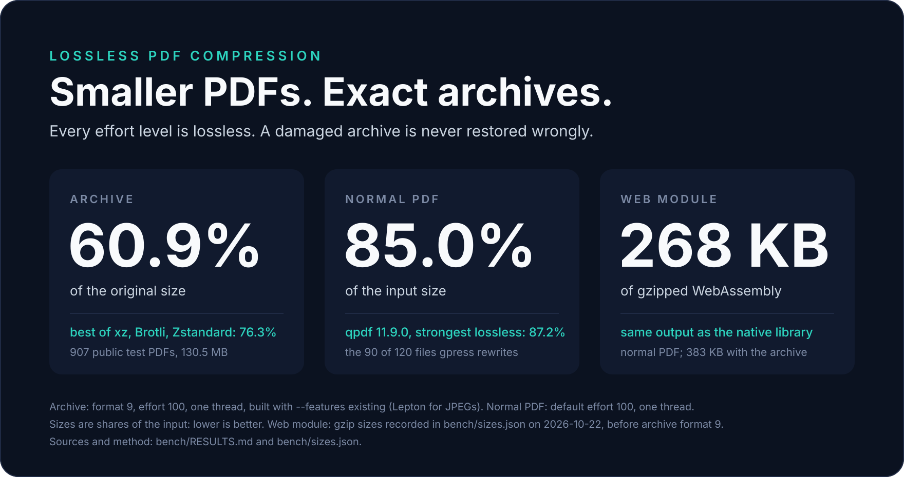
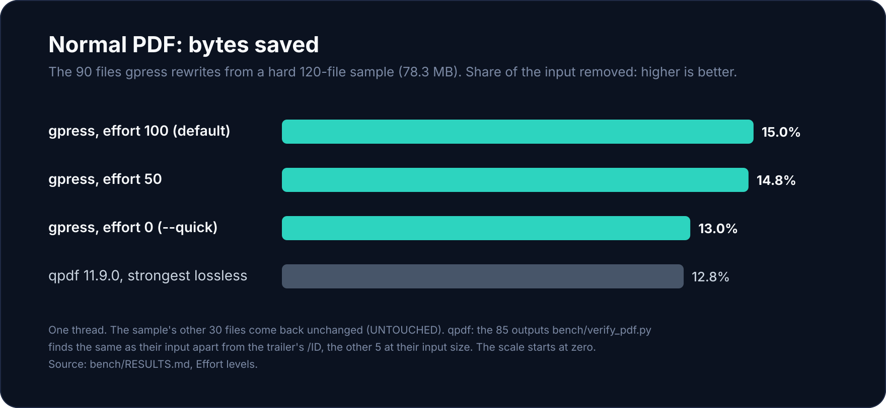
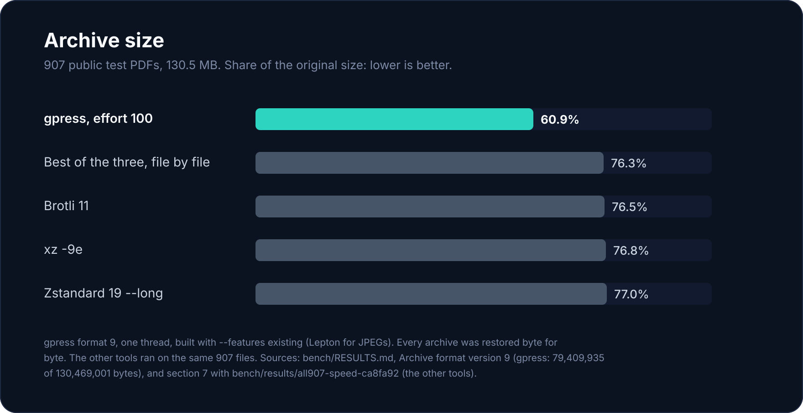

<p align="center">
  <picture>
    <source media="(prefers-color-scheme: dark)" srcset="docs/assets/logo-dark.svg">
    
  </picture>
</p>

<h1 align="center">gpress</h1>

<p align="center">
  <em>Lossless PDF compression: smaller PDFs that standard readers open,<br>and an archive that restores byte for byte.</em>
</p>

<p align="center">
  <a href="https://github.com/soumyadebroy3/gpress/actions/workflows/ci.yml"></a>
  <a href="https://github.com/soumyadebroy3/gpress/actions/workflows/codeql.yml"></a>
  
  
  
  <a href="#licence"></a>
</p>

<p align="center">
  <a href="#benchmarks"></a>
</p>

<p align="center">
  <strong>Archives about 20% smaller than the best of xz, Brotli and Zstandard</strong><br>
  <strong>Normal PDFs 2.5% smaller in total than qpdf 11.9.0's strongest lossless output, on the files gpress rewrites</strong><br>
  <strong>Every effort level lossless &middot; 268 KB gzipped in the browser for normal PDFs, 383 KB with the archive</strong><br>
  <sub>Archive: 907 public test PDFs, format 9, effort 100, built with Lepton. Normal PDF: totals on the 90 files gpress rewrites from a hard 120-file sample, default effort. One thread. Browser: the gzip sizes of the two WebAssembly modules, as recorded in bench/sizes.json on 2026-10-22, before archive format 9. <a href="#benchmarks">Details</a>.</sub>
</p>

<p align="center">
  <sub><a href="#quick-start">Quick start</a> &middot; <a href="#install">Install</a> &middot; <a href="#use-it-from-code">From code</a> &middot; <a href="#benchmarks">Benchmarks</a> &middot; <a href="docs/reference.md">Reference</a> &middot; <a href="SECURITY.md">Security</a></sub>
</p>

---

gpress is a library written in Rust, with C and WebAssembly bindings and a command-line tool. It makes two kinds
of output, and checks each one before it returns it, except the archive's rare fallback and a file stored as it is (below).

> [!IMPORTANT]
> Version 0.1.0, in active development: the API may still change, and nothing is published to crates.io or npm
> yet, so everything below builds from this repository. The archive format is version 9: archives from earlier
> development versions are refused, except one a format-8 build stored uncompressed, which still restores. CI builds and tests on Linux (x86-64).

## Two outputs

| | Normal PDF | gpress archive (`.gpz`) |
| --- | --- | --- |
| **Call** | `optimize` | `compress` / `expand` (`pack` / `unpack` on the command line) |
| **Takes** | a PDF | any file, a PDF above all |
| **Gives** | a smaller PDF that standard readers open, with every reachable object's value preserved (objects the trailer can't reach, directly or through other objects, are dropped) | an archive that restores the original byte for byte |
| **How** | streams compressed again with gpress's Flate encoders, a better PNG predictor for images, optimal Huffman tables for JPEGs (the same coefficients), CCITT fax images as JBIG2 (the same pixels), objects in compressed object streams | a PDF-aware context-mixing model |
| **Checked** | the output is read back and compared with the input before it is returned; anything uncertain is left as it was | the archive is restored and compared before it is returned; if that check ever fails, gpress writes a simpler model-only archive instead (not checked again). Either way the file is stored as it is when that is smaller. `expand` checks every archive's restored length and a 128-bit SHA-256 prefix against its header |
| **On bad input** | a file it can't safely touch comes back unchanged, with the reason | a damaged archive is refused with an error, or restored exactly when the damage misses what it needs; it is never restored wrongly |

## Quick start

```sh
gpress optimize in.pdf out.pdf            # a smaller PDF that standard readers open
gpress optimize in.pdf out.pdf --quick    # the same at effort 0, the fast path
gpress pack in.pdf in.gpz                 # the gpress archive (works on any file)
gpress unpack in.gpz back.pdf             # the original, byte for byte
```

`optimize` prints one tab-separated line: the input, `SMALLER` or `UNTOUCHED`, bytes in, bytes out, seconds and
the details. `pack` prints the input, bytes in, bytes out, seconds, then `PACKED` or `STORED` with the archive's
statistics. For `tests/data/format-v9.pdf`, copied to `in.pdf`:

```
in.pdf	SMALLER	8791	4955	0.15	objects=6 streams=2 reencoded=2 kept=0 objstms=1 dropped=1 jpegs_retabled=0 fax_to_jbig2=0
in.pdf	8791	6963	0.10	PACKED streams=3 rebuilt=3 rebuilt_bytes=7909 lepton=0 type1=0 fax=0 decrypted=0 decoded_bytes=54664
```

A file `optimize` can't make smaller or can't safely touch (a signed file, PDF/A, a file with earlier revisions,
an encrypted file that needs a password, a damaged one) is written to `out.pdf` unchanged, with `UNTOUCHED` and
the reason.

<details>
<summary><b>Every command, and the exit status</b></summary>

`gpress` without arguments lists every option, and the engine's measuring commands (`deflate`, `inflate`,
`batch`, `jpeg`, `fax-decode`, `expand` (it decodes streams; restoring an archive is `unpack`), ...) used for checks
and benchmarks; the comments at the top of
[`src/bin/gpress.rs`](src/bin/gpress.rs) name them. The exit status is 0 when the call worked, 2 for a
usage or file error, and otherwise the library's error code (for example 2 for a damaged archive, 6 when
`--time-budget` ran out; the full list is in the same comments).

</details>

## Install

You need a recent stable Rust ([rustup](https://rustup.rs)); CI uses the latest stable release.

**The command-line tool**

```sh
cargo install --locked --git https://github.com/soumyadebroy3/gpress gpress
```

Add `--features existing` to also use [Lepton](https://crates.io/crates/lepton_jpeg) (Apache-2.0) for JPEG
streams in the archive. An archive with parts Lepton made restores only with such a build.

<details>
<summary><b>From a clone</b></summary>

```sh
git clone https://github.com/soumyadebroy3/gpress
cd gpress
cargo build --release            # the tool is target/release/gpress
```

`--features existing` works here too.

</details>

<details>
<summary><b>As a Rust library</b></summary>

```toml
[dependencies]
gpress = { git = "https://github.com/soumyadebroy3/gpress" }
```

</details>

<details>
<summary><b>As a C library</b></summary>

```sh
cargo build --release -p gpress-c
```

This builds `libgpress_c` as a shared and a static library in `target/release/` (`libgpress_c.so` and
`libgpress_c.a` on Linux), with the header [`crates/gpress-c/include/gpress.h`](crates/gpress-c/include/gpress.h).
On Linux:

```sh
cc -Icrates/gpress-c/include app.c target/release/libgpress_c.a -lpthread -ldl -lm -o app   # static
cc -Icrates/gpress-c/include app.c -Ltarget/release -lgpress_c -o app                      # shared: run it with
LD_LIBRARY_PATH=target/release ./app                                                         # the library on its path
```

</details>

<details>
<summary><b>As a WebAssembly module (browser and Node)</b></summary>

```sh
rustup target add wasm32-unknown-unknown
cd crates/gpress-wasm/js
npm ci
npm run build                    # dist/: gpress.js, gpress.d.ts, gpress.wasm, gpress-web.wasm
```

The build runs binaryen's `wasm-opt` on the modules when it is on `PATH`; install binaryen for the smallest
modules.

</details>

## Effort levels

`--effort N` (the `effort` option) runs from 0, the fastest, to 100, the smallest; the default is 100.
**Every level is lossless**: they differ only in how hard the engine searches, and every level's output is
checked the same way. The output is the same for any thread count.

<p align="center">
  
</p>

| Effort | What runs (normal PDF) | CPU time, first measured | CPU time, build 37bd3f3 | Output |
| --- | --- | ---: | ---: | ---: |
| 0 (`--quick`) | The fast path: our fast Flate encoder, image predictors chosen from an estimate, and the cheap steps (object streams, the cross-reference stream, JPEG tables, JBIG2) | 16.1 s | 16.8 s | 87.02% |
| 5 | The bridge: closer parses for images | 23.0 s | | 86.70% |
| 10 | The bridge, plus the strong encoder's quick settings for the streams that take the most room, within a budget that doubles every point | 40.7 s | | 86.11% |
| 15 | | 111 s | | 85.74% |
| 19 | | 183 s | | 85.59% |
| 20 | The strong encoder, its settings in steps of 20, the strongest that fits a work budget proportional to the file's size | 244 s | | 85.43% |
| 50 | | 334 s | 176 s | 85.17% |
| 100 (default) | The strong encoder at its strongest | 983 s | 512 s | 85.01% |
| qpdf 11.9.0, strongest lossless setting | For comparison | 25.3 s | | 87.23% |

<details>
<summary><b>How these were measured</b></summary>

CPU time is for the whole 120-file sample (`bench/sets/sample120.txt`, 78.3 MB, a deliberately hard mix of the
slowest, the largest and random files) on one thread; output is the total size as a share of the input on the 90
files the engine rewrites. For qpdf it counts the 85 outputs `bench/verify_pdf.py` finds the same as their input
apart from the trailer's /ID, and the other 5 files at their input size; its setting is `--object-streams=generate
--compress-streams=y --recompress-flate --compression-level=9 --decode-level=specialized`. On the 118 files qpdf can open
(it refused 2 encrypted files) the comparison turns around: qpdf rewrites each of them, dropping earlier
revisions, unreferenced objects and whatever it cannot read, while gpress returns the files it can't safely touch
unchanged. Counting those as they are, an
earlier build (ca8fa92) gave 90.2% of the input at effort 100 on those 118 files, against 74.7% for qpdf with
object streams and Flate at level 9. The first
measurement (builds 52a91f0 and 20f8e69) was made in October 2026 for the change that added the fast path, on a
4-core 2.1 GHz Xeon virtual machine. Later changes made the strong encoder faster. Build 37bd3f3 was measured
again at efforts 0, 50 and 100, and at each effort its outputs total exactly the first run's bytes. It ran on a
machine about 1.2 times slower by the benchmark's calibration, so the two time columns compare only roughly.
At those three efforts the current code gives the same outputs; its one later change on this path, the JBIG2
decoder that reads fax images back (717bf45), was not timed. The other levels were not measured again: their
times and outputs are the first run's. Both runs, with their builds and calibrations,
are in [bench/RESULTS.md](bench/RESULTS.md#effort-levels). In the archive, data that already looks compressed
is coded plainly below effort 50. The [reference](docs/reference.md#options) has the details.

</details>

## Use it from code

### Rust

```rust
use gpress::{Options, Outcome};

let opt = Options::new().effort(80).threads(4);

// A smaller PDF that standard readers open.
let r = gpress::optimize(&pdf_bytes, &opt)?;
match r.outcome {
    Outcome::Smaller(_report) => std::fs::write("out.pdf", &r.data)?,
    Outcome::Untouched(why) => println!("left as it was: {why}"),
}

// The gpress archive, and the original back from it.
let archive = gpress::compress(&pdf_bytes, &opt)?;
let original = gpress::expand(&archive.data, &opt)?;
assert_eq!(original, pdf_bytes);
```

`optimize`, `compress` and `expand` each run inside a panic guard, so a bug that panics comes back as
`Error::Internal` (in a build with `panic = "abort"`, such as the WebAssembly module below, it aborts). The
engine's own types, public too for measuring ([reference](docs/reference.md#options)), have no guard.

<details>
<summary><b>Errors and outcomes</b></summary>

Errors are a plain `Error` enum with a stable numeric code and a message without internal paths:

| Code | Meaning | Code | Meaning |
| ---: | --- | ---: | --- |
| 1 | input too large | 6 | time budget ran out |
| 2 | damaged archive | 7 | declared length over the limit |
| 3 | unsupported archive version | 8 | needs the existing library |
| 4 | internal | 9 | declared decoded total over the limit |
| 5 | invalid options | 10 | needs a part this build leaves out ([building only what a product needs](docs/reference.md#building-only-what-a-product-needs)) |

`Optimized.outcome` says what happened: `Smaller` with a `Report` (objects, streams re-encoded and kept, object
streams, JPEGs given new tables, fax images written as JBIG2, how the file is encrypted), or `Untouched` with
the reason. `Compressed` carries the archive's statistics (streams rebuilt, through Lepton, Type 1 fonts opened,
fax images, streams stored decrypted, decoded bytes, and `stored` when nothing could be made smaller).

</details>

<details>
<summary><b>C, and everything that binds to C</b></summary>

```c
gpress_options opt; gpress_options_default(&opt); opt.effort = 70;
gpress_result r = gpress_optimize(pdf, pdf_len, &opt);
if (r.code == GPRESS_OK) fwrite(r.output.data, 1, r.output.len, out);
else fprintf(stderr, "%s\n", r.message);
gpress_result_free(&r);
```

Every function is thread-safe and never reads outside the buffers it is given. It never aborts the process on
bad input, and a bug that panics comes back as an error. Like any Rust code it does abort if memory runs out, so set
the size limits to what the host can afford. Every buffer it hands out is freed with `gpress_result_free` (or
`gpress_free` / `gpress_free_message`, each given the field's address), which are safe on null and on a result
already freed: a free clears what it freed, so a double free or a part freed before the whole result is
harmless by construction. An empty output is a null pointer with length 0. The options struct has the same
fields as the Rust `Options` but `store_budget`, which stays at its default (fill it with
`gpress_options_default` first; a size left at 0 means its default).
[`crates/gpress-c/examples/roundtrip.c`](crates/gpress-c/examples/roundtrip.c) is a complete program, and
`bench/gpress_harness.c` sends the security suite's hostile inputs through this API.

</details>

<details>
<summary><b>JavaScript and TypeScript (browser and Node)</b></summary>

`crates/gpress-wasm` is a plain WebAssembly module (no bindgen layer) with a typed wrapper in
[`js/gpress.ts`](crates/gpress-wasm/js/gpress.ts):

```ts
import { Gpress } from "./dist/gpress.js";                         // built in crates/gpress-wasm/js; not on npm yet
const g = await Gpress.load(fetch("/gpress.wasm"));                 // or gpress-web.wasm: no archive, smaller
// In Node, pass a file URL (or a path from the working directory) instead:
// await Gpress.load(new URL("./dist/gpress.wasm", import.meta.url))
const smaller = g.optimize(bytes, { effort: 70, jbig2: false });   // { data, outcome, reason? }
const archive = g.compress(bytes);
const original = g.expand(archive.data, { maxLenMiB: 512 });       // throws GpressError on a damaged archive
```

The module gives the same bytes as the native library (the web module too, for `optimize`; see
[Building only what a product needs](docs/reference.md#building-only-what-a-product-needs)), is
single-threaded and has no clock (so no time budget: run it in a Web Worker to keep a page responsive and to
end it when it has taken too long). It is built with `panic = "abort"` (`wasm32-unknown-unknown` aborts on a
panic anyway), so the panic guard that turns a bug into `Error::Internal` natively catches nothing there: a bug,
or a failed memory growth in the engine, traps the module, and the wrapper turns the trap into a `GpressError` with code 4 and
marks the instance dead (load a fresh one). Sizes are 32-bit inside it: the wrapper refuses inputs of 2 GiB and
more. Pages with a Content Security Policy need `'wasm-unsafe-eval'` in its `script-src`.

A first load compiles the module (4 to 9 ms in Node for the module of [PR #8](https://github.com/soumyadebroy3/gpress/pull/8),
[bench/RESULTS.md](bench/RESULTS.md#start-up-the-webassembly-module-in-node), Start-up; CI's WebAssembly job measures it
again in every run).
`Gpress.compile(source)` returns the compiled module, and `Gpress.load(module)` makes an instance from it
without compiling again: compile once, then make one instance per worker (a module can be posted to a Web
Worker) or a fresh one after a trap. Serve the file as `application/wasm`, with no parameters, so that it
compiles while it downloads (with any other type it is compiled once it has arrived).

</details>

## Options

Everything a caller of `optimize`, `compress` and `expand` can tune is a field of `Options`, and every field is a flag of the command-line tool. The
ones most callers need:

| Option | Flag | Default | What it does |
| --- | --- | --- | --- |
| `effort` | `--effort N`, `--quick` | 100 | 0 (fastest) to 100 (smallest), see above. |
| `threads` | `--threads N` | 0 | 0: every core the machine offers, at most 8; at most 64. The output is the same for any count. |
| `time_budget` | `--time-budget MS` | none | Give up after this much wall time: an error and no output, the input unchanged. |
| `max_input` | `--max-input BYTES` | 1 GiB | Larger inputs are refused at once. |
| `max_len` | `--max-len BYTES` | 1 GiB | Expand: an archive declaring a larger original is refused before anything is decoded. |
| `max_decoded` | `--max-decoded BYTES` | 256 MiB | Archive: the most decoded bytes the parts of one archive may claim, both ways. |
| `respect_conformance` | `--ignore-conformance` | on | Normal PDF: leave PDF/A, PDF/X, signed, certified and usage-rights files untouched. |
| `jpeg_tables`, `jbig2`, `flate_over_jpeg` | `--no-jpeg-tables`, `--no-jbig2`, `--no-flate-over-jpeg` | on | Normal PDF: turn single steps off. |

Every other option, the memory each limit bounds, the parts of the engine a build can leave out
(`--no-default-features --features ...`, for example the smaller `web` build without the archive), how
encrypted PDFs are handled and what each part of the engine does are in the [reference](docs/reference.md).

## Benchmarks

Measured on 907 public test PDFs (130.5 MB: the pdf.js, pypdf, OCRmyPDF and pikepdf test suites, many of them
deliberately broken or unusual), fetched and pinned by `bench/fetch_corpus.sh`, and on a deliberately hard
120-file sample of them (`bench/sets/sample120.txt`, 78.3 MB). Sizes were the same on every machine they were measured on.

<p align="center">
  
</p>

| What | gpress | Compared with |
| --- | --- | --- |
| Archive, 907 files, effort 100, built with `--features existing` (Lepton) | 60.9% of the original size | the best of xz -9e, Brotli 11 and Zstandard 19 --long, file by file: 76.3% |
| Archive, the 120-file sample, effort 100, default build (no Lepton) | 60.0% | the best of the three, file by file: 74.5% |
| Normal PDF, the 90 files gpress rewrites from the sample, default effort | 85.01% of the input | qpdf 11.9.0, strongest lossless setting: 87.23% |

Every archive in those runs was restored by a separate process and compared byte for byte, and the competitors ran on the same files. All three
rows are the current code: the archive rows are format 9, and the current code's normal-PDF outputs total exactly
the bytes behind its row (see [Effort levels](#effort-levels), which also says how qpdf does when every file it opens is
counted).

<details>
<summary><b>Earlier measurements</b></summary>

These come from the first full run (build d85cd7a), and [bench/RESULTS.md](bench/RESULTS.md) says which build
and machine each figure comes from. Later builds changed the normal-PDF output and the archive format, so they
are not figures for the current code.

- **Normal PDF on all 907 files, maximum effort:** 16.0% smaller on the 697 files it rewrote; qpdf (object
  streams, Flate at level 9) made the same files 9.3% smaller. Every one of those 697 outputs was compared with
  its original by tools we didn't write: qpdf, pikepdf, PDFium, Poppler and pdf.js.
- **Every distinct Flate stream on its own (7,280 streams):** 41.05 MB; Zopfli (15 iterations) 0.67% larger,
  libdeflate 12 1.40% larger, zlib 9 6.95% larger.

`bench/benchmark.py` measures any build.

</details>

## Safety

- **No data loss.** Every transformation of a normal PDF is checked before it is used, and anything uncertain
  leaves that stream or file untouched. A damaged archive is refused with an error, or restored exactly when the damage misses what it needs; it is never
  restored wrongly.
- **Untrusted input.** Sizes are bounded by `Options`, by the file's own size or by a fixed limit, decoding stops
  when data runs out, nothing a file claims sizes memory on its own, and no call to `optimize`, `compress` or
  `expand` panics across the library boundary. What no option bounds yet: cross-reference streams decode as far as the file's size allows, the
  PDF/A check reads metadata up to 16 MiB, and objects parsed from object streams take more memory than the bytes
  the limits count (see `max_stream` in the [reference](docs/reference.md#options)).
- **Deterministic.** The same bytes for any thread count and with or without a time budget (tested); the model
  uses integer arithmetic only, its constants are fixed in code and never read from the environment, and the
  WebAssembly module is checked against the native library's bytes.
- **Licences.** Libraries under MIT, Apache-2.0, BSD, ISC, Zlib, Unicode or MPL-2.0 only
  ([the licence rule](docs/reference.md#the-licence-rule)): `cargo deny` checks every dependency's licence and
  the RustSec advisories in CI.

[SECURITY.md](SECURITY.md) has the threat model, the guarantees with where each is kept, how they are checked,
and how to report a vulnerability privately.

## What's inside

Most of the engine is our own code. The parts that follow another project's code (zlib, libdeflate, the LZMA
SDK) say so and keep its licence notice, as listed in
[Code from other projects](docs/reference.md#code-from-other-projects). A default build's only outside libraries
are RustCrypto's AES, MD5 and SHA-2, for encrypted PDFs, and the small crates they use, all MIT OR Apache-2.0
(`cargo tree` lists them).

## Build and test

CI (`.github/workflows/ci.yml`) runs on every pull request and every push to `main`, and its last job,
"All checks passed", passes only when every other job did. CodeQL (`.github/workflows/codeql.yml`) scans the
Rust, TypeScript, Python and workflow code on every pull request and weekly.

<details>
<summary><b>The commands</b></summary>

```
cargo build --release --workspace                 # the library, the C library and the tool (and the wasm crate, built natively)
cargo build --release --features existing         # also lepton_jpeg (Apache-2.0)
cargo test --release --workspace
cargo test --release --workspace --features existing
cargo test --release --workspace --no-default-features --features web   # or any other set of features
cargo clippy --workspace --all-targets -- -D warnings
cargo fmt --all --check
cargo deny check                                  # and python3 -I bench/check_dep_sources.py
cargo build --profile wasm -p gpress-wasm --target wasm32-unknown-unknown   # needs: rustup target add wasm32-unknown-unknown
(cd crates/gpress-wasm/js && npm ci && npm run build && npm test)      # the npm package into js/dist/ (with wasm-opt if on PATH)
(cd crates/gpress-wasm/js && npm run test:web)    # the same tests on the web module
python3 -I bench/sizes.py check                   # fails if the web module's gzip size is over 400 KB or more than 5% over bench/sizes.json; needs wasm-opt
(cd fuzz && cargo +nightly fuzz run expand -- -max_total_time=600)    # needs cargo-fuzz; also inflate, pdf_optimize
```

</details>

<details>
<summary><b>What CI and the tests cover</b></summary>

CI runs formatting, clippy with warnings as errors on both feature sets, both test suites, clippy and the tests
again for the builds that leave parts out (none of them, the web set, and every part but one), the C example
against the shared library, the licence and advisory gate, the WebAssembly package with the tests on both
modules and the web module's size budget, a short fuzzing run of the archive decoder, the Flate decoder and the
PDF path, a secret scan of every commit (gitleaks) and a security audit of the workflows themselves (zizmor).

`tests/features.rs` checks each part's absence in the builds without it, and the other test files run in every
build each test whose parts it has (`tests/bounds.rs`, `speed.rs` and `memory.rs` test the normal PDF in the web
build too); `tests/api.rs` shows every option reaching the engine, one at a time, and that the thread count, the store budget and a time budget that doesn't run out never change the output; `tests/interaction.rs` runs
every feature on an encrypted document (as RC4 and as AES) holding a JPEG, a fax image, a Type 1 font and a zlib
stream, in both outputs; `tests/pack_format.rs` keeps an archive made by the first build of the format version
(`tests/data/format-v9.*`), which must still restore and pack to the same bytes.

The benchmark suite, the security suite and the independent checks are in `bench/` (described in the
[reference](docs/reference.md#benchmarks-bench)); [docs/optimisation-plan.md](docs/optimisation-plan.md) and
[docs/tasks/](docs/tasks/README.md) hold the plan and the briefs for the work in progress.

</details>

## Contributing

Pull requests are welcome. Every pull request runs the CI and CodeQL above and is merged only once they pass; the
pull request template lists what to run locally first. A change must keep outputs exact (the archive restores byte for byte, a normal PDF
keeps every reachable object's value), and any speed, size or memory figure in a pull request must be measured,
saying how and on which files. New dependencies must come from crates.io under a licence on `deny.toml`'s list. Dependabot proposes dependency and action updates every week. To report a vulnerability, see
[SECURITY.md](SECURITY.md) rather than opening an issue.

## Licence

gpress is licensed under either of

- Apache License, Version 2.0 ([LICENSE-APACHE](LICENSE-APACHE) or <https://www.apache.org/licenses/LICENSE-2.0>)
- MIT licence ([LICENSE-MIT](LICENSE-MIT) or <https://opensource.org/licenses/MIT>)

at your option. The files listed in [Code from other projects](docs/reference.md#code-from-other-projects) also
carry the licence notices of the projects they follow, which apply to those parts too and must be kept.

Unless you explicitly state otherwise, any contribution intentionally submitted for inclusion in gpress by you,
as defined in the Apache-2.0 licence, shall be dual licensed as above, without any additional terms or
conditions.
